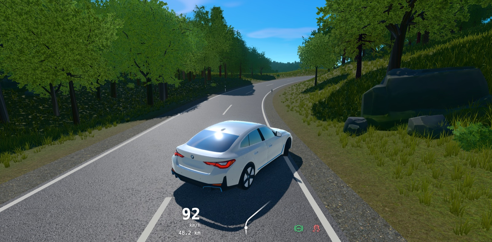

# drive

A relaxing endless drive through rolling hills and forests, right in your browser.

**Play at [drive.st1.io](https://drive.st1.io)**



Drive with WASD or the arrow keys, pause with Escape, switch cars with C (a BMW i4, a 1963
VW Beetle and a Ferrari 488 Pista). The Beetle's flat four and the Ferrari's twin-turbo V8
are simulated piston by piston, and they are what you hear: see [engine/](engine/).

## Run locally

```sh
bun install
bun run dev
```

The engine simulation is Rust compiled to WebAssembly; the built `src/sim/engine.wasm` is
checked in. To rebuild it: `rustup target add wasm32-unknown-unknown`, then
`bun run build-engine`.

## Inspiration

Inspired by [slowroads.io](https://slowroads.io), which I've sunk far too many hours into.

## License

[MIT](LICENSE). Third-party models and textures keep their own licences; see
[CREDITS.md](CREDITS.md).
